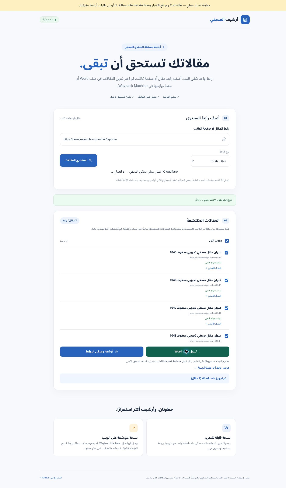

# مراجعة Turnstile — 2 نوفمبر 2026

## النطاق والنتيجة

بدأت المراجعة من [49e94e0](https://github.com/moeltaher/journalist-archive/commit/49e94e0efc5077072b0f3b51c0519f5e01f0c48a). نجحت الاختبارات الثلاثون الأصلية محليًا. يؤكد [سجل GitHub Actions الأصلي](https://github.com/moeltaher/journalist-archive/actions/runs/41358174452) نجاح الاختبارات عند 22:38:57 UTC يوم 1 نوفمبر، ويؤكد [فحص Workers Builds](https://github.com/moeltaher/journalist-archive/runs/125002756920) نجاح بناء Cloudflare عند 22:39:17 UTC. لا يختبر أي من هذين السجلين استخراجًا حيًا من ناشر أو حفظًا فعليًا في Internet Archive.

الإصلاحات موجودة في فرع `fix/turnstile-session-recovery` للمراجعة. لم تُغيّر إعدادات Production أو مفاتيحه، ولم تُرسل عملية أرشفة حقيقية أثناء العمل.

## الأعطال المثبتة والإصلاح

| الحالة | السلوك السابق | السلوك بعد الإصلاح |
| --- | --- | --- |
| تغيّر عنوان الشبكة قبل انتهاء تصريح الاستخراج | يحتفظ المتصفح بالتصريح المرفوض ويعيد استعماله في الاكتشاف والصفحات التالية وWord | إبطال التصريح المحدد وتجديده، ثم إعادة الطلب مرة واحدة فقط |
| انتهاء تصريح الأرشفة أو تغيّر الشبكة أثناء الدفعة | تستخدم جميع الطلبات والمتابعات التصريح القديم؛ تستمر محاولة المتابعة رغم رفضه | تجديد مشترك قبل الطلب أو بعد رفض مصنّف؛ متابعة معرف المهمة المقبولة نفسه |
| تحدٍ تفاعلي انتهت مهلته أو لم يصل أي رد منه | لا توجد معالجة `timeout-callback` أو مهلة قصوى؛ قد تبقى الأزرار معطلة | معالجة انتهاء التحدي ومهلة انتظار دقيقتين وإعادة إتاحة المحاولة |
| رد متأخر من اختبار سابق | ردود الواجهة القديمة تحسم الوعد الحالي للعملية نفسها | واجهة جديدة لكل محاولة، وردود لا تؤثر إلا في المحاولة التي أنشأتها |
| خطأ متزامن أثناء `render()` | يقع قبل تسجيل الطلب المعلّق، فيُفقد الخطأ | تسجيل المحاولة قبل الإنشاء ومعالجة أخطاء الإنشاء والتنفيذ |
| اتصال Siteverify لا يستجيب | لا توجد مهلة صريحة لطلب التحقق | إلغاء الطلب بعد 15 ثانية ورفض إصدار التصريح |
| فشل استخراج مرتبط بـ Turnstile | الرسالة تطلب الضغط على زر الأرشفة حتى في مسار الاستخراج | رسالة تلائم العملية، مع رموز أخطاء منفصلة للتصريح والتحقق |
| فقد الرد على طلب أرشفة | يظهر فشل قاطع رغم احتمال وصول الطلب للخدمة | حالة غير مؤكدة، دون إعادة الإرسال تلقائيًا |
| عرض حالة Internet Archive | وجود المفاتيح يوصف بأنه اتصال مفعّل | النص يميز إعداد المفاتيح عن قبول الطلب الفعلي |

أُضيفت ثلاثة اختبارات إلى وحدة Turnstile قبل إصلاحها؛ فشلت عند انتهاء التحدي، والرد المتأخر، والخطأ المتزامن أثناء الإنشاء، ثم نجحت بعد التعديل. كشف فحص المتصفح أيضًا مشكلة في استدعاء مؤقت النسخة المعدلة بسياق `this` غير صالح، وأُصلحت قبل التسليم مع إضافة اختبار يمنع عودتها.

## مستويات التحقق

| المستوى | ما جرى اختباره | حدود الدليل |
| --- | --- | --- |
| اختبارات Node | دورة حياة Turnstile، التوقيع والنطاق والصلاحية، تجديد التصاريح المتزامن، حدود إعادة المحاولة، DOCX | واجهة Turnstile محاكاة |
| تشغيل الواجهة في DOM محاكى | إدخال مقال، كاتب، دفعة تالية، Word، الأرشفة، إعادة المحاولة، الانتقال بين العمليات واستعادة المؤشر بعد إعادة التحميل | يستخدم linkedom وواجهات API محاكية؛ ليس متصفحًا حقيقيًا |
| Worker محلي | تنفيذ `src/worker.js` وHTMLRewriter وHMAC وDurable Object داخل Miniflare، مع اكتشاف 45 مقالًا ثم 7 إضافية واستخراج النص وتوليد Word | ردود Siteverify والناشر وInternet Archive محاكاة؛ الاختبار يمنع الخروج إلى الشبكة. تاريخ توافق المحاكي 2026-07-30، بينما إعداد الإنتاج 2026-10-31 |
| متصفح Chrome فعلي | استخراج مقال، إنشاء Word، أرشفة محاكاة والانتقال للتقرير، اكتشاف صفحة كاتب من 45 مقالًا ثم 7 إضافية، إنشاء Word للدفعة التالية | التطبيق والخادم المحليان يعملان، لكن تحدي Turnstile والخدمات الخارجية محاكاة |
| تنزيل Word في المتصفح | ظهرت نتيجة إنشاء الملف لمقال واحد ولسبعة مقالات وأُطلق مسار التنزيل | لم تُلتقط إشارة اكتمال التنزيل من أداة المتصفح؛ لا يُدّعى التحقق من حفظ الملف على القرص. بنية DOCX ونصه تحقق منهما اختبار مستقل |
| Turnstile/Siteverify الحيان | غير مختبرين | لم يتوفر رابط النشر العام الدقيق في المستودع أو سياق الجلسة |
| اتصال Cloudflare الحي بمواقع الأخبار | غير مختبر | استخراج HTML في المحاكي لا يثبت أن الناشر يسمح بطلبات Worker المنشور |
| Internet Archive الحقيقي | لم تُرسل طلبات حفظ فعلية | نتيجة المحاكاة لا تثبت صحة مفاتيح الحساب أو الحصة أو نجاح الحفظ |

### التغطية الآلية

تغطي المجموعة 79 اختبارًا. تشمل رفض رمز Turnstile المنتهي والمكرر وذي العملية أو المضيف المختلف، رفض تصاريح موقعة منتهية أو معدّلة أو من متصفح وشبكة مختلفين، رفض الاستعمال عبر مصادر وناشرين مختلفين، وتجديدًا واحدًا مشتركًا للطلبات المتزامنة. تختبر أيضًا غياب المكتبة أو المفتاح، تغيير المفتاح أثناء التحدي، غياب موضع العرض أو إخفاءه، عدم دعم المتصفح، وفشل Siteverify أو عودته ببيانات غير مفهومة.

طلبات الأرشفة لا تعاد بعد خطأ شبكة أو HTTP 502/429 أو 403 عام. إعادة الطلب مسموحة مرة واحدة فقط عند `ARCHIVE_AUTH_REQUIRED` الصادر قبل أي إرسال خارجي. يفحص اختبار Worker أن التصريح المرفوض يمنع الاتصال بالناشر أو Internet Archive. عند فشل التجديد نهائيًا تتوقف بقية الدفعة غير المرسلة، وتبقى متابعة الطلبات المقبولة منفصلة عن إعادة الإرسال.

لإعادة تنفيذ الاختبارات استخدم `npm ci` ثم `npm test` على Node 22 أو أحدث. تنفذ GitHub Actions هذين الأمرين أيضًا. تُحفظ الاعتماديات في `package-lock.json`، ولا تحتاج الاختبارات مفاتيح حقيقية. توفر `tests/preview-server.mjs` معاينة محلية تستخدم الردود التجريبية نفسها.

### دليل المتصفح المحلي

توضح الصورة الدفعة التالية وإنشاء Word من سبعة مقالات، مع تنبيه صريح أعلى الصفحة إلى استخدام المحاكاة.

## ما يلزم لإغلاق الاختبار الحي

يلزم عنوان النسخة المنشورة للتأكد من تحميل ملف الواجهة الجديد ومكتبة Cloudflare ومن مطابقة `hostname` و`action` عند إصدار تصريح حقيقي. بعدها تُختبر مادة منشورة وصفحة كاتب فعلية والدفعة التالية وتنزيل Word، ويُعاد الاختبار بعد تبديل الشبكة أو انتهاء التصريح. لا تُسجّل الرموز أو المفاتيح في التقرير.

يُفحص Internet Archive بصورة مستقلة. وجود مفاتيحه في `/api/status` لا يختبر صلاحيتها. يمكن متابعة مهمة حقيقية قائمة إن توفر معرفها والتصريح المناسب، دون إنشاء أرشفة جديدة. يظل اختبار الحفظ الكامل بحاجة إلى مادة محددة يراد حفظها فعلًا، مع التحقق من نتيجة Save Page Now ورابط النسخة المحفوظة.

لا يغطي فحص المتصفح المحلي جهاز Android فعليًا، أو سياسات CSP والنطاق المسموح على إعداد Turnstile الإنتاجي، أو تغيّرات مواقع الأخبار. ونجاح اختبارات الفرع لا يعني أن الإصلاحات نُشرت على `main`.

## المراجع التقنية

- [Cloudflare — التحقق على الخادم وصلاحية الرمز واستخدامه مرة واحدة](https://developers.cloudflare.com/turnstile/get-started/server-side-validation/)
- [Cloudflare — العرض الصريح ودورة حياة الواجهة](https://developers.cloudflare.com/turnstile/get-started/client-side-rendering/)
- [Cloudflare — ردود انتهاء المهلة وإعدادات المحاولة والتجديد](https://developers.cloudflare.com/turnstile/get-started/client-side-rendering/widget-configurations/)
